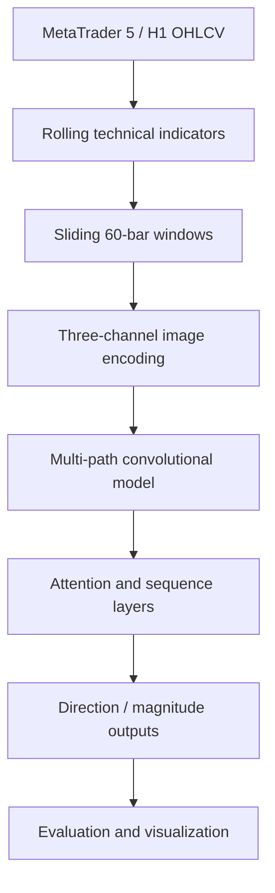

<div align="center">


**Market Vision — визуальное представление рынка для машинного обучения**

Методика преобразования многомерных рыночных индикаторов в изображения, обучения моделей и анализа решений нейросети.

[Постановка](#исследовательская-задача) · [Архитектура](#реальная-архитектура) · [Модель](#представление-признаков-и-модель) · [Проверка](#научная-достоверность) · [Запуск](#практическое-воспроизведение)

</div>

> **Статус: исследовательский ML-прототип.** В репозитории существует исполняемый Python-исходник; отсутствие версионированного OOS-отчёта и независимых прогонов не позволяет считать указанные в прежнем описании проценты точности воспроизведённым результатом.

## Исследовательская задача

Финансовые временные ряды имеют несколько разнородных измерений: OHLC, объём, трендовые оценки, импульс и волатильность. Проект исследует гипотезу, что визуальный кодировщик, объединяющий эти величины в RGB-представление, позволяет моделям извлекать устойчивые закономерности из совместной геометрии признаков. Цель будущей валидации — проверить, даёт ли эта геометрия преимущества относительно классических табличных моделей при одинаковых условиях прогноза и вычислений.

**Практическая ценность:** воспроизводимая цепочка «рыночные данные → признаки → изображения → нейросеть → объяснение прогноза». Потенциальная область применения — лаборатория машинного обучения, визуальный анализ рыночных режимов и исследование интерпретируемости. Прибыльная торговая стратегия исходным кодом не доказана.

## Реальная архитектура



В исходном `computer_vision_trading.py` присутствуют отдельные функции для подключения MT5, получения данных, построения индикаторов, создания изображений, построения модели, обучения, оценки и формирования графических диагностик.

| Компонент | Код | Роль |
|:--|:--|:--|
| Источник данных | `connect_to_mt5`, `get_historical_data` | История EURUSD H1 через MetaTrader 5 (по умолчанию) |
| Признаки | `add_technical_indicators` | SMA, EMA, MACD, RSI, Bollinger, Stochastic, ATR, momentum, ROC, volatility |
| Изображение | `create_2d_images` | Скользящие окна признаков и целевые прогнозные окна |
| Нейросеть | `create_2d_cnn_model` | Архитектура со свёрточными, последовательностными и attention-компонентами |
| Обучение | `train_model` | Обучение и Keras callbacks |
| Оценка | `evaluate_model` | Метрики и сравнительные графики |
| Объяснение | `visualize_attention_maps` | Визуальный анализ внимания |
| Применение | `make_prediction_with_visualization` | Исследовательская визуализация прогноза |
| Видео | `create_prediction_animation` | Анимация результатов |

## Представление признаков и модель

Первичный массив котировок преобразуется в DataFrame с индексом времени. В `add_technical_indicators` формируются скользящие характеристики, в том числе SMA(7, 25, 99), EMA(12, 26), MACD, RSI(14), Bollinger(20), стохастик и ATR(14). Неполные после прогрева строки удаляются.

В `create_2d_images` используется окно `window_size=60`, горизонт `prediction_window=24`, а размер изображения по умолчанию `128×128`. Список полей включает 19 рыночных и индикаторных измерений. Нормализация и сопоставление их RGB-каналам требуют отдельного теста на сохранение временной причинности.

Важное методологическое различие: свёрточная модель может распознавать особенности **кодирования**, которые не соответствуют будущей информации рынка. Поэтому работающий классификатор и информативное изображение не означают наличия статистически значимого предиктивного преимущества.

## Научная достоверность

### Критические условия эксперимента

1. **Temporal split:** разделение train/validation/test должно быть строго хронологическим. Случайное перемешивание перекрывающихся окон способно создать утечку между выборками.
2. **Purging и embargo:** близкие окна, имеющие общие данные или будущие целевые свечи, должны быть разделены временным зазором.
3. **Train-only preprocessing:** любые параметры нормализации, отбирающие статистику сразу по большому набору, подбираются только на обучающем интервале. Нормализация внутри текущего окна допустима только при использовании истории, доступной в момент решения.
4. **Baseline:** сравнить с majority class, логистической регрессией, деревьями решений/градиентным бустингом и простой последовательностной нейросетью на тех же данных.
5. **Interpretability sanity checks:** attention maps не являются автоматически причинными объяснениями. Нужны perturbation, occlusion и ablation.
6. **Economics:** accuracy и MAE нельзя переводить в торговую доходность без spread, slippage, комиссии, изменения режима рынка и корректного risk sizing.

| Уровень утверждения | Нынешний подтверждённый статус |
|:--|:--|
| Присутствует исходный код RGB-представления | Да |
| Присутствует код многокомпонентной ML-архитектуры | Да |
| Есть визуализации и функции оценки | Да, реализация в исходнике |
| Есть сохранённый воспроизводимый независимый OOS-бенчмарк | Не установлен |
| Доказано превосходство над равным табличным baseline | Нет |
| Доказана финансовая доходность | Нет |
| Проведён независимый security / engineering audit | Не подтверждён |

## Практическое воспроизведение

```bash
git clone https://github.com/Shtenco/computer_vision_trading_metatrader_5.git
cd computer_vision_trading_metatrader_5
python computer_vision_trading.py
```

Исполнение требует совместимых Python, TensorFlow/Keras, MetaTrader5, OpenCV, SciPy, NumPy, pandas, sklearn и визуальных библиотек. Зависимости в этом репозитории пока не представлены полноценным lock-файлом; запуск и обучение в текущей среде **не выполнялись**.

## Технические ограничения и план

| Приоритет | Задача | Критерий завершения |
|:--|:--|:--|
| P0 | Сформировать датасет со строгой отметкой времени и хэшем | Frozen split manifest |
| P0 | Изолировать оконный кодировщик и цель | Unit tests и запрет lookahead |
| P0 | Заменить случайное разделение перекрывающихся окон на purged walk-forward | Уникальные интервалы train/test |
| P1 | Запинить версии зависимостей и seed | Повторение одной оценки |
| P1 | Сравнить с сильными табличными моделями | Общий OOS по тем же датам |
| P1 | Проверить attention и RGB-компоненты через ablation | Отдельный отчёт по каждому компоненту |
| P2 | Ввести costed trading benchmark | Net PnL, DD, turnover, sensitivity |
| P2 | Добавить CI и release evidence | Automated tests + artifacts |

## Инженерное значение

Этот проект показывает попытку соединить **обработку сигналов, технические индикаторы, компьютерное зрение и глубокое обучение** в едином исследовательском конвейере. Его демонстрационная ценность — алгоритмический подход и конкретный код. Его научная перспектива — создание строгой, сравнимой и опровержимой процедуры проверки гипотезы о полезности RGB-кодирования рынка.

Предыдущие версии описаний сохранены в [историческом README](docs/README_LEGACY.md). Исторические заявления о точности не следует считать независимо подтверждёнными.

---

[Исходники](https://github.com/Shtenco/computer_vision_trading_metatrader_5) · [SYNERGY SYSTEM](https://github.com/Shtenco/synergy_system)
